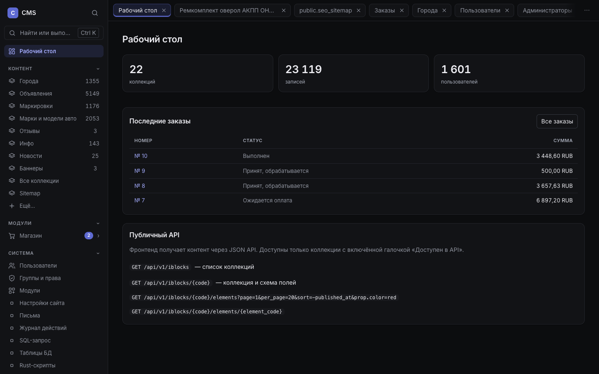
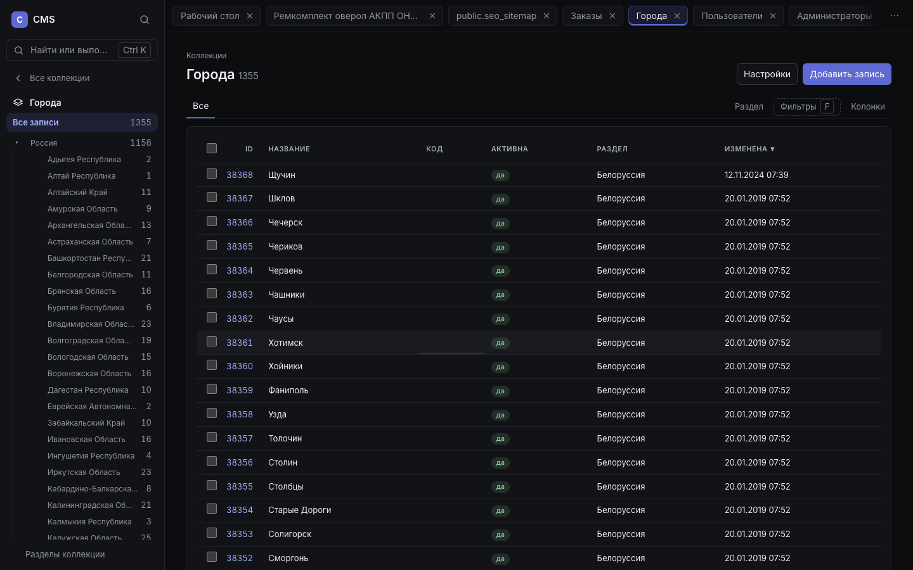
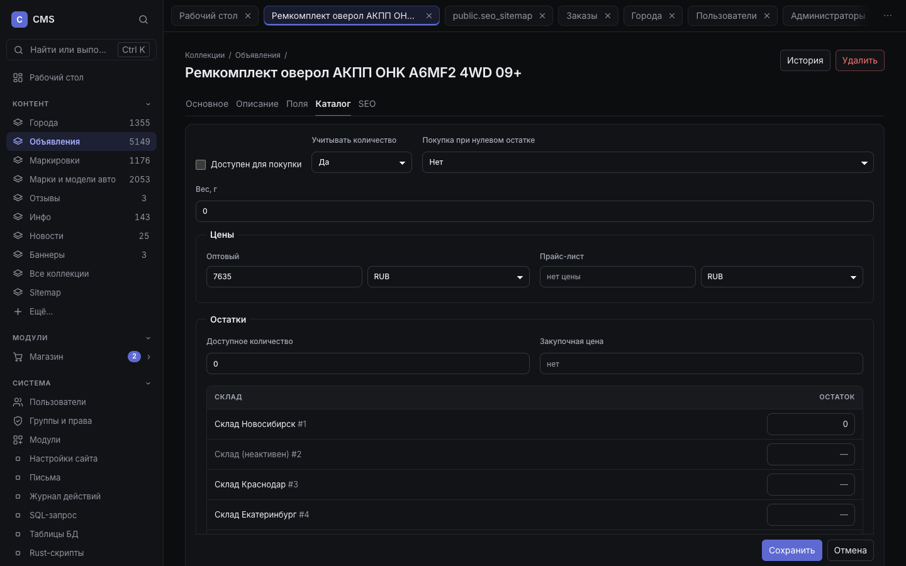
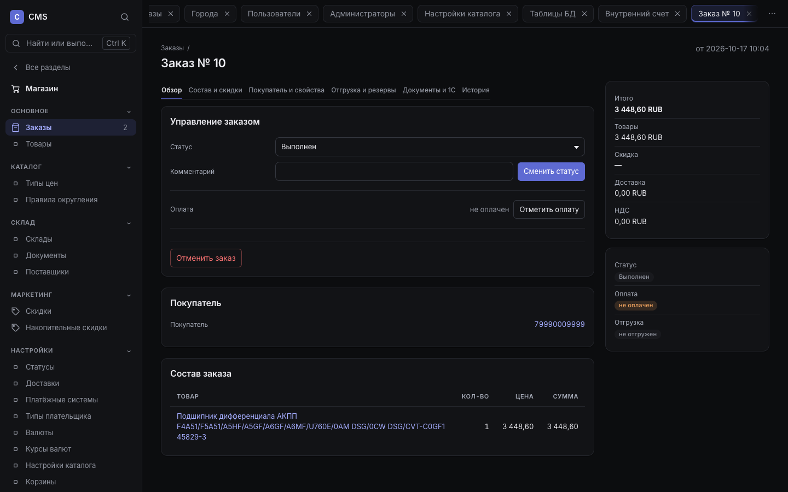
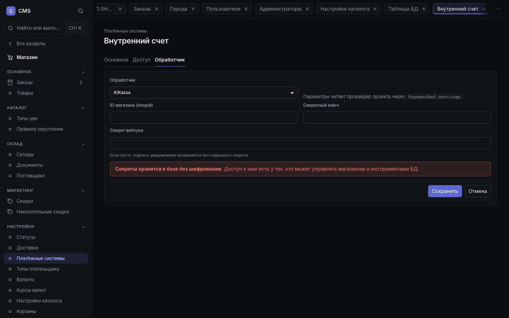

# CMS на Rust вместо Битрикс:Бизнес (без CRM)

Презентация для тимлида и руководителя. 10–15 минут.
Дата: 2026-11-13. Подробности — [readiness.md](readiness.md),
[benchmark-v2.md](benchmark-v2.md), [bitrix-parity.md](bitrix-parity.md).

---

## 1. Что предлагаем

Headless CMS + интернет-магазин на Rust — замена **контентной и магазинной
части Битрикс:Бизнес**. Фронтенд остаётся прежним: CMS реализует
bxapi-совместимый контракт `mediagroup.bxapi`, поэтому витрина не
переписывается.

**Не обещаем:** CRM, задачи, календарь, телефонию, почтовый клиент. Это вне
скоупа; синхронизация с Битрикс24 через вебхуки — возможное будущее, не
текущая функция.

---

## 2. Что уже работает

| Блок | Возможности |
|---|---|
| Контент | Коллекции, разделы, поля всех основных типов, блочный редактор, версии, поиск, SEO, sitemap, импорт из Битрикса |
| Магазин | Каталог, цены, валюты, склады, остатки, резервы, партии, документы, себестоимость |
| Заказы | Корзина, оформление, статусы, оплата, доставка, скидки, купоны, НДС, возвраты, повтор заказа |
| Пользователи | Регистрация, подтверждение почты, вход, восстановление, профиль, группы и права |
| Интеграции | bxapi, формы, SMTP и шаблоны писем, обмен с 1С, платёжные провайдеры проекта |
| Админка | Списки, фильтры, вкладки, массовые действия, журнал, SQL/таблицы/Rust — только суперадминам |

---

## 3. Контент и каталог

- Одна модель для новостей, статей, товаров, справочников: коллекция + поля +
  разделы; ничего не нужно программировать для нового типа контента.
- Блочный контент вместо HTML: заголовки, текст, картинки, галереи, цитаты,
  таблицы, HTML с очисткой.
- Версии записей и журнал действий; импорт из Битрикса одной командой.
- У товара — цены по типам, остатки по складам, флаги доступности.

---

## 4. Заказы и оплата

- Полный цикл: корзина → оформление → оплата → статус → повтор.
- Платёжные системы с явными настройками обработчика: ID магазина, секретный
  ключ, секрет вебхука; ядро передаёт их провайдеру в `PaymentRef.settings`.
- Сейчас в админке поддержана ЮKassa; остальные провайдеры подключаются кодом
  проекта. Секреты хранятся в БД без шифрования — это ограничение и
  предупреждение в интерфейсе.
- Возвраты фиксируются в CMS; проведение у провайдера — ручное/проектное.

---

## 5. API для фронта

Фронт TransOpt уже работает с CMS без правок — проверено на реальных
запросах:

- каталог: список, карточка, разделы, поиск, схемы;
- корзина и оформление заказа;
- оплата и состояние платежа;
- профиль, заказы, повтор;
- авторизация, регистрация, подтверждение, сброс пароля;
- формы, навигация, location, sitemap/SEO.

Совместимость — с контрактом `mediagroup.bxapi`, **не со всем REST API
Битрикса**. В репозитории 1360 автоматических тестов (4 ignored), clippy/fmt
чистые; тесты покрывают основные сценарии bxapi.

---

## 6. Производительность

Замер 2026-11-13: оба приложения **в Docker**, за nginx, одинаковые POST-тела
фронта, один набор данных, только чтение. 2 полных перемежающихся раунда;
второй собирался при паузах хоста, поэтому в скобках — разброс отношений,
а третий раунд исключён. Это не SLA и не «предел» ни одной из систем.
Подробно — [benchmark-v2.md](benchmark-v2.md).

### Один пользователь (c=1), медиана p50

| Ручка | CMS | Битрикс | Разница |
|---|---:|---:|---:|
| Карточка товара | 5,1 мс | 39,8 мс | **7,9× (7,7–8,0×)** |
| Список товаров | 8,0 мс | 37,3 мс | **4,7× (4,5–4,9×)** |
| Разделы каталога | 5,9 мс | 34,3 мс | **5,9× (5,8–6,0×)** |
| Поиск U660 | 6,1 мс | 56,1 мс | **8,9× (7,2–10,6×)** |
| Схемы (72–190 КБ) | 8,0 мс | 374,4 мс | **43,3× (21,8–64,8×)** |

### 16 клиентов: throughput

| Ручка | CMS, rps | Битрикс, rps | Разница |
|---|---:|---:|---:|
| Карточка товара | 676 | 41 | **16,9× (15,2–18,7×)** |
| Список товаров | 601 | 84 | **8,3× (6,2–10,3×)** |
| Разделы каталога | 830 | 94 | **15,6× (6,7–24,5×)** |
| Поиск U660 | 1 027 | 64 | **36,5× (9,7–63,3×)** |
| Схемы | 486 | 6,1 | **97,0× (60,6–133,3×)** |

Память в простое: CMS — **27 МБ**, php-fpm Битрикса с 32 воркерами — **345 МБ**
(плюс nginx). Цифры — локальный dev-стенд и Docker Desktop на macOS, не SLA;
у Битрикса был Xdebug off, OPcache/JIT on, `pm=static`, 32 воркера.

---

## 7. Границы и риски

| Ограничение | Что это значит |
|---|---|
| Нет CRM/задач/телефонии | Это не замена Битрикс24; только контент и магазин |
| Одна установка — один проект | `project/mod.rs` компилируется в бинарник; мультисайта нет |
| Платежи | В админке только ЮKassa; остальное — код проекта и регламент возвратов |
| Маркетинг | Нет рассылок/сегментов/кампаний; есть шаблоны писем |
| Мультисайт | Нет домены/сайты в одной админке |
| Bitrix REST/экосистема | Совместим только bxapi-контракт фронта |
| Антибот | Капча на регистрации/сбросе не реализована |
| Эксплуатация | Нет CI, автоматических бэкапов, трейсинга; лимиты в памяти инстанса |
| Масштабирование | Очередь писем и лимиты рассчитаны на один инстанс |

**P0 перед пилотом:** антибот, общие лимиты, автобэкапы, CI, проверка
платежей/вебхуков и живой 1С, нагрузочный тест на production-объёме.

---

## 8. Что показываем вживую

1. Рабочий стол и коллекции: создать запись, добавить блок, сохранить версию.
2. Импорт из Битрикса и открытие знакомого фронта без правок API.
3. Заказ: корзина → оплата → статус → повтор.
4. Склад: остатки, резерв, документ.
5. Платёжная система: обработчик и секреты.
6. Инструменты супер-админа: SQL, таблицы, Rust — как аналог Bitrix-тулзов.

**Следующий шаг:** согласовать пилот на одном проекте без CRM, закрыть P0 и
зафиксировать SLA/объём данных. После этого — решать про поток проектов и
автоматизацию деплоя.
